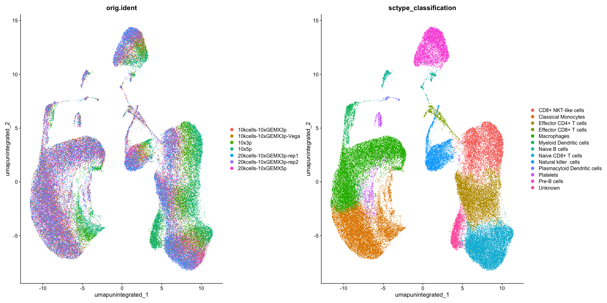
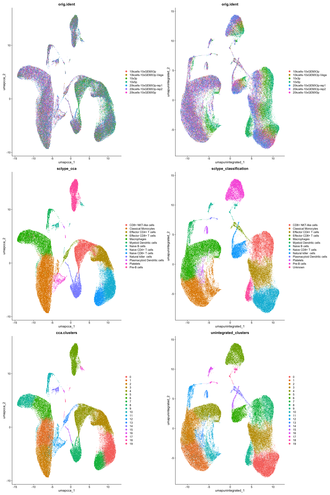

# Description of single-cell RNA-sequencing analyis of 7 PBMC datasets

## Libraries used in our analysis.
``` r
library(dplyr)
library(Seurat)
library(patchwork) 
library(Matrix)
library(SeuratData)
library(biomaRt)
library(HGNChelper)
library(AnnotationHub)
library(AnnotationDbi)
library(ensembldb)
library(ggplot2)
```
## Loading the "GenexCell matrix" generated by IG28.
``` r
# Load the cell-gene matrix and convert to a Seurat compatible format
tab <- read.table("/path/to/gene_cell_counts.tsv", header=TRUE, row.names=1, check.names=FALSE)
mat <- as(as.matrix(tab), "dgCMatrix")
pbmc <- CreateSeuratObject(counts = mat)
pbmc[["RNA"]] <- split(pbmc[["RNA"]], f = pbmc$orig.ident)
```
## Mitochondrial gene labeling.
``` r
# Mitochondrial genes need to be labeled for filtering purposes.
# Depending on the gene names or ID used different methods can be applied.
# IG28 uses by default ENSEMBL IDs as gene identifiers so we used the AnnotationHub library for the labeling.
# Process:
# Load list of mitochondrial genes.
ah <- AnnotationHub()
EnsDb.Homo <- query(ah, pattern = c("Homo sapiens", "EnsDb"))
edb <- EnsDb.Homo[[length(EnsDb.Homo)]]
# Extract gene IDs in the dataset.
gene_ids <- rownames(pbmc)
genes_stripped <- sub("\\..*$", "", gene_ids)
# Find the corresponding gene names given by the ENSEMBL IDs in the dataset.
anno <- AnnotationDbi::select(
  edb,
  keys = genes_stripped,
  keytype = "GENEID",
  columns = c("GENEID", "SEQNAME")
)
# Annotate the mitochondrial genes.
mito_ensembl <- unique(anno$GENEID[anno$SEQNAME == "MT"])
mito_features <- gene_ids[genes_stripped %in% mito_ensembl]

# Calculate the percentage of mitochondrial genes.
pbmc[["percent.mt"]] <- PercentageFeatureSet(pbmc, features = mito_features)
pbmc[["is.mt.gene"]] <- rownames(pbmc) %in% mito_ensembl

# Visualize QC metrics as a violin plot.
VlnPlot(pbmc, features = c("nFeature_RNA", "nCount_RNA", "percent.mt"), ncol = 3)
```

## Standard processing

For the first part of our analysis, we followed the workflow described in the R vignette [Seurat - Guided Clustering Tutorial](https://satijalab.org/seurat/articles/pbmc3k_tutorial) from the Seurat v5 website.\
We performed:\
-Cell filtering based on number of genes (nFeature) per cell, keeping cells with a number of gene between 350 and 4000,
and percentage of mitochondrial genes (percent.mt), keeping cells with less than 20% mitochondrial genes;\
-Data normalization (used the "LogNormalize" method);\
-Identified the top 2000 most variable features;\
-Scaled the data;\
-Performed linear dimensional reduction with PCA;\
-Determine the 'dimensionality' of the dataset with the elbow plot method;\
-Cluster the cells;\
-Performed non-linear dimensional reduction with UMAP.\

## Cell filtering.
``` r
pbmc_subset <- subset(pbmc, subset = nFeature_RNA > 350 & nFeature_RNA < 4000 & percent.mt < 20)
```

## Data normalization.
``` r
pbmc_subset <- NormalizeData(pbmc_subset, normalization.method = "LogNormalize", scale.factor = 10000)
```

## Identification of highly variable features.
``` r
pbmc_subset <- FindVariableFeatures(pbmc_subset, selection.method = "vst", nfeatures = 2000)
```

# Scaling gene expression.
``` r
all.genes <- rownames(pbmc_subset)
pbmc_subset <- ScaleData(pbmc_subset, features = all.genes)
```

# Linear dimensionality reduction with PCA.
``` r
pbmc_subset <- RunPCA(pbmc_subset, features = VariableFeatures(object = pbmc_subset))
```

## Determination of the dataset "dimensionality".
``` r
ElbowPlot(pbmc_subset)
```

## Cluster cells.
``` r
pbmc_subset <- FindNeighbors(pbmc_subset, dims = 1:11, reduction = "pca")
pbmc_subset <- FindClusters(pbmc_subset, resolution = 0.5, cluster.name = "unintegrated_clusters")
```

# Non linear dimensionality reduction with UMAP.
``` r
pbmc_subset <- RunUMAP(pbmc_subset, dims = 1:11, reduction = "pca", reduction.name = "umap.unintegrated")
```

## Automatic cell type assignment with ScType on uncorrected data.
``` r
# Load gene set preparation function.
source("https://raw.githubusercontent.com/IanevskiAleksandr/sc-type/master/R/gene_sets_prepare.R")
# Load cell type annotation function.
source("https://raw.githubusercontent.com/IanevskiAleksandr/sc-type/master/R/sctype_score_.R")
# Load database file.
db_ <- "https://raw.githubusercontent.com/IanevskiAleksandr/sc-type/master/ScTypeDB_full.xlsx";
tissue <- "Immune system" # e.g. Immune system,Pancreas,Liver,Eye,Kidney,Brain,Lung,Adrenal,Heart,Intestine,Muscle,Placenta,Spleen,Stomach,Thymus 

# Prepare gene sets.
gs_list <- gene_sets_prepare(db_, tissue)

# Convert gene names in the gene sets to ENSEMBL ID to match the IG28 output.
# Create a list of gene names from the gene sets used by ScType to assign clusters.
all_symbols <- unique(unlist(gs_list))

# Load gene identifier convertion database.
mart <- useMart("ensembl", dataset = "hsapiens_gene_ensembl")
# Get ENSEMBL IDs.
mapping <- getBM(attributes = c("hgnc_symbol", "ensembl_gene_id"),
                 filters = "hgnc_symbol",
                 values = all_symbols,
                 mart = mart)
# Remove duplicate mappings.
mapping_unique <- mapping[!duplicated(mapping$ensembl_gene_id), ]
mapping_unique <- mapping_unique[!duplicated(mapping_unique$hgnc_symbol), ]
mapping_unique <- mapping_unique[!is.na(mapping_unique$hgnc_symbol), ]
mapping_unique <- mapping_unique[!is.na(mapping_unique$ensembl_gene_id), ]
keys <- mapping_unique$hgnc_symbol
values <- mapping_unique$ensembl_gene_id
map_values <- function(x) {
  values[match(x, keys)]
}
# Generate gene set list with ENSEMBL IDs.
gs_list_ensembl <- lapply(gs_list, function(L2) {
  lapply(L2, function(L3) {
    lapply(L3, map_values)
  })
})

# Subset Seurat object to only include mapped genes.
rownames(pbmc_subset) <- genes_stripped

# Extract scaled scRNA-seq matrix.
scRNAseqData_scaled <- as.matrix(pbmc_subset[["RNA"]]$scale.data)

# Run ScType.
es.max <- sctype_score(scRNAseqData = scRNAseqData_scaled, scaled = TRUE, gs = gs_list_ensembl$gs_positive, gs2 = gs_list_ensembl$gs_negative)

# Merge by cluster.
cL_results <- do.call("rbind", lapply(unique(pbmc_subset$unintegrated_clusters), function(cl){
    es.max.cl = sort(rowSums(es.max[ ,rownames(pbmc_subset[[]][pbmc_subset$unintegrated_clusters==cl, ])]), decreasing = !0)
    head(data.frame(cluster = cl, type = names(es.max.cl), scores = es.max.cl, ncells = sum(pbmc_subset$unintegrated_clusters==cl)), 10)
}))
sctype_scores <- cL_results %>% group_by(cluster) %>% top_n(n = 1, wt = scores)  

# Set low-confidence (low ScType score) clusters to "Unknown".
sctype_scores$type[as.numeric(as.character(sctype_scores$scores)) < sctype_scores$ncells/4] <- "Unknown"
print(sctype_scores[,1:3])

# Assign cell type classification to cells.
pbmc_subset$sctype_classification = ""
for(j in unique(sctype_scores$cluster)){
  cl_type = sctype_scores[sctype_scores$cluster==j,]; 
  pbmc_subset$sctype_classification[pbmc_subset$unintegrated_clusters == j] = as.character(cl_type$type[1])
}
```

``` r
DimPlot(pbmc_subset, reduction = "umap.unintegrated", repel = TRUE, group.by = c('orig.ident', 'sctype_classification'))        
```

    ## Rasterizing points since number of points exceeds 100,000.
    ## To disable this behavior set `raster=FALSE`
    ## Rasterizing points since number of points exceeds 100,000.
    ## To disable this behavior set `raster=FALSE`

<!-- -->

## Batch correction using Anchor-based Canonical Correlation Analysis (CCA) integration with Seurat.
``` r
pbmc_subset <- IntegrateLayers(
  object = pbmc_subset, method = CCAIntegration,
  orig.reduction = "pca", new.reduction = "integrated.cca",
  verbose = FALSE
)
```
## Cluster cells based on the integrated data.
``` r
pbmc_subset <- FindNeighbors(pbmc_subset, reduction = "integrated.cca", dims = 1:11)
pbmc_subset <- FindClusters(pbmc_subset, resolution = 0.5, cluster.name = "cca.clusters")
```

## Automatic cell type assignment with ScType on integrated data.
``` r
# Load gene set preparation function.
source("https://raw.githubusercontent.com/IanevskiAleksandr/sc-type/master/R/gene_sets_prepare.R")
# Load cell type annotation function.
source("https://raw.githubusercontent.com/IanevskiAleksandr/sc-type/master/R/sctype_score_.R")
# Load database file.
db_ <- "https://raw.githubusercontent.com/IanevskiAleksandr/sc-type/master/ScTypeDB_full.xlsx";
tissue <- "Immune system" # e.g. Immune system,Pancreas,Liver,Eye,Kidney,Brain,Lung,Adrenal,Heart,Intestine,Muscle,Placenta,Spleen,Stomach,Thymus 

# Prepare gene sets.
gs_list <- gene_sets_prepare(db_, tissue)

# Convert gene names in the gene sets to ENSEMBL ID to match the IG28 output.
# Create a list of gene names from the gene sets used by ScType to assign clusters.
all_symbols <- unique(unlist(gs_list))
# Load gene identifier convertion database.
mart <- useMart("ensembl", dataset = "hsapiens_gene_ensembl")
# Get ENSEMBL IDs.
mapping <- getBM(attributes = c("hgnc_symbol", "ensembl_gene_id"),
                 filters = "hgnc_symbol",
                 values = all_symbols,
                 mart = mart)
# Remove duplicate mappings.
mapping_unique <- mapping[!duplicated(mapping$ensembl_gene_id), ]
mapping_unique <- mapping_unique[!duplicated(mapping_unique$hgnc_symbol), ]
mapping_unique <- mapping_unique[!is.na(mapping_unique$hgnc_symbol), ]
mapping_unique <- mapping_unique[!is.na(mapping_unique$ensembl_gene_id), ]
keys <- mapping_unique$hgnc_symbol
values <- mapping_unique$ensembl_gene_id
map_values <- function(x) {
  values[match(x, keys)]
}
# Generate gene set list with ENSEMBL IDs.
gs_list_ensembl <- lapply(gs_list, function(L2) {
  lapply(L2, function(L3) {
    lapply(L3, map_values)
  })
})

# Subset Seurat object to only include mapped genes.
rownames(pbmc_subset) <- genes_stripped

# Extract scaled scRNA-seq matrix.
scRNAseqData_scaled <- as.matrix(pbmc_subset[["RNA"]]$scale.data)

# Run ScType.
es.max <- sctype_score(scRNAseqData = scRNAseqData_scaled, scaled = TRUE, gs = gs_list_ensembl$gs_positive, gs2 = gs_list_ensembl$gs_negative)

# Merge by cluster.
cL_results <- do.call("rbind", lapply(unique(pbmc_subset$cca.clusters), function(cl){
    es.max.cl = sort(rowSums(es.max[ ,rownames(pbmc_subset[[]][pbmc_subset$cca.clusters==cl, ])]), decreasing = !0)
    head(data.frame(cluster = cl, type = names(es.max.cl), scores = es.max.cl, ncells = sum(pbmc_subset$cca.clusters==cl)), 10)
}))
sctype_scores <- cL_results %>% group_by(cluster) %>% top_n(n = 1, wt = scores)  

# Set low-confidence (low ScType score) clusters to "unknown"
sctype_scores$type[as.numeric(as.character(sctype_scores$scores)) < sctype_scores$ncells/4] <- "Unknown"
print(sctype_scores[,1:3])

# Assign cell type classification to cells.
pbmc_subset$sctype_cca = ""
for(j in unique(sctype_scores$cluster)){
  cl_type = sctype_scores[sctype_scores$cluster==j,]; 
  pbmc_subset$sctype_cca[pbmc_subset$cca.clusters == j] = as.character(cl_type$type[1])
}
```
## Plotting UMAP visualization of sample of origin, cell clustering and cell type assignment in both unintegrated and CCA integratad data.
``` r
p1 <- DimPlot(
  pbmc_subset,
  reduction = "umap.cca",
  group.by = c("orig.ident", "sctype_cca", "cca.clusters"),
  combine = FALSE, label.size = 2
)
```

    ## Rasterizing points since number of points exceeds 100,000.
    ## To disable this behavior set `raster=FALSE`
    ## Rasterizing points since number of points exceeds 100,000.
    ## To disable this behavior set `raster=FALSE`
    ## Rasterizing points since number of points exceeds 100,000.
    ## To disable this behavior set `raster=FALSE`

``` r
p2 <- DimPlot(
  pbmc_subset,
  reduction = "umap.unintegrated",
  group.by = c('orig.ident', 'sctype_classification', "unintegrated_clusters"),
  combine = FALSE, label.size = 2 group.by = c('orig.ident', 'sctype_classification', "unintegrated_clusters"))
```

    ## Rasterizing points since number of points exceeds 100,000.
    ## To disable this behavior set `raster=FALSE`
    ## Rasterizing points since number of points exceeds 100,000.
    ## To disable this behavior set `raster=FALSE`
    ## Rasterizing points since number of points exceeds 100,000.
    ## To disable this behavior set `raster=FALSE`

``` r
wrap_plots(c(p1, p2), ncol = 2, byrow = F)
```

<!-- -->

## Saving a cell-to-cell type mapping file for IG28.
``` r
# Save a tsv file with cell barcodes and corresponding cell types.
# Barcodes are the column names of the Seurat object.
barcodes <- colnames(pbmc_subset)

# Metadata holds TransferData outputs (e.g.cluster identities or cell type assignments).
md <- pbmc_subset@meta.data

# Create a dataframe with two columns: barcodes and cell types.
out <- data.frame(
  barcode = barcodes,
  cell_type = md[["sctype_cca"]],
  stringsAsFactors = FALSE
)

# Write the dataframe to file.
write.table(out, file = "cellbarcode_celltype_map.tsv", sep = "\t",
            quote = FALSE, row.names = FALSE)
```
## Saving RDS file with the analyzed data.
``` r
# Save the file with all the analyzed data.
saveRDS(pbmc, file = "seurat_analysis.rds")
```
