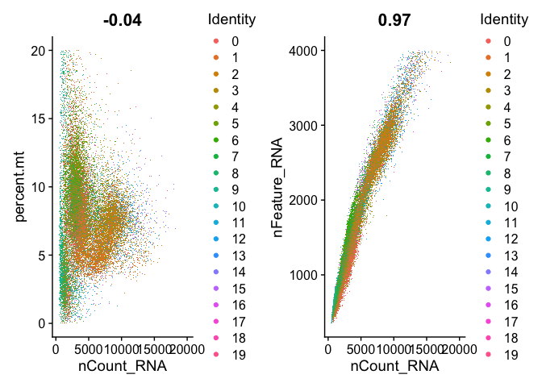
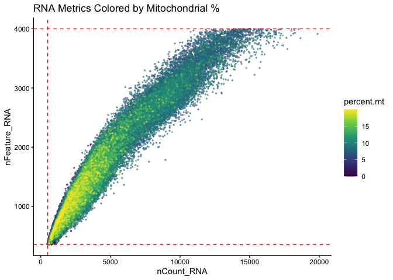
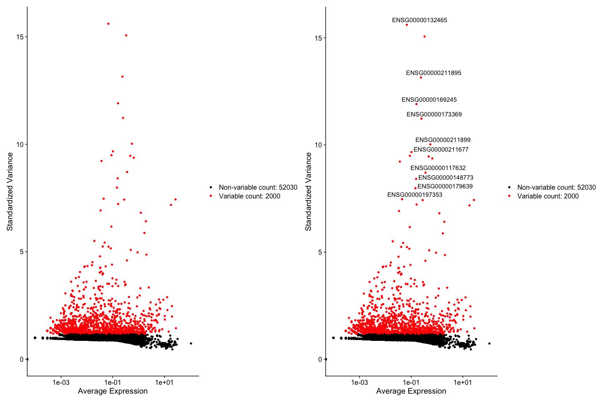
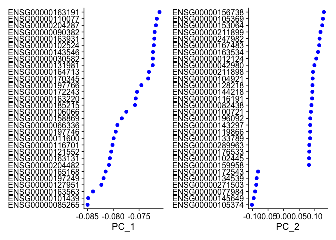
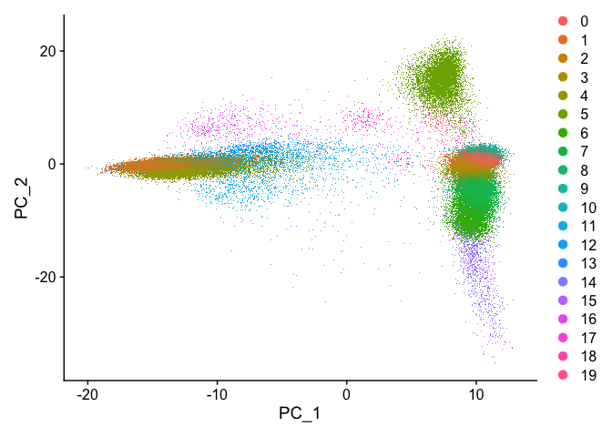
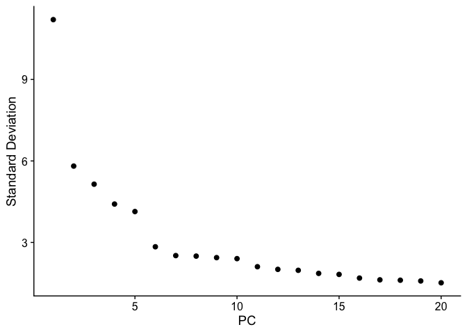
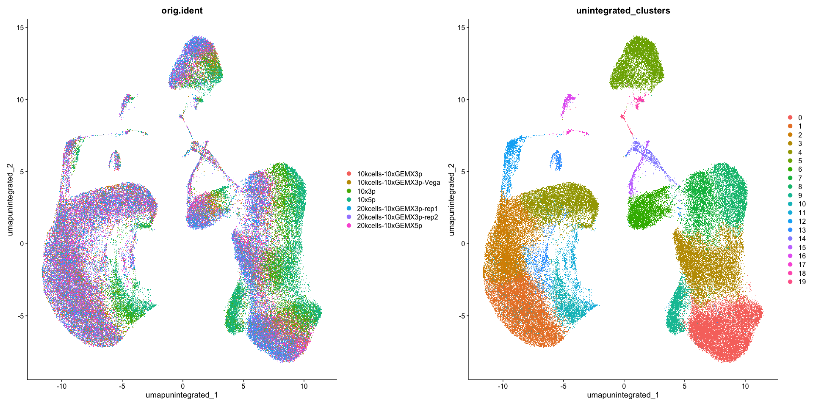
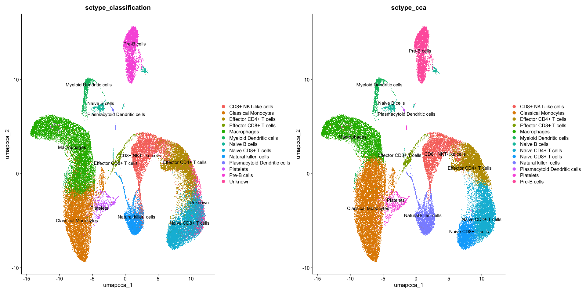

R Notebook
================

``` r
# Libraries
library(dplyr)
library(Seurat)
library(patchwork) 
library(Matrix)
library(SeuratData)
library(biomaRt)
library(HGNChelper)
library(AnnotationHub)
library(AnnotationDbi)
library(ensembldb)
library(ggplot2)
```

``` r
# Load the cell-gene matrix and convert to a seurat compatible format
tab <- read.table("/Volumes/holocron7/singlecell_mando/Combined_PBMC/IG28_output/Combined/tmp/gene_cell_counts.tsv", header=TRUE, row.names=1, check.names=FALSE)
mat <- as(as.matrix(tab), "dgCMatrix")
pbmc <- CreateSeuratObject(counts = mat)
pbmc[["RNA"]] <- split(pbmc[["RNA"]], f = pbmc$orig.ident)
rm(tab)
rm(mat)
```

``` r
# Load list of mitochondrial genes
ah <- AnnotationHub()
EnsDb.Homo <- query(ah, pattern = c("Homo sapiens", "EnsDb"))
edb <- EnsDb.Homo[[length(EnsDb.Homo)]]
# Extract gene IDs in the dataset
gene_ids <- rownames(pbmc)
genes_stripped <- sub("\\..*$", "", gene_ids)
# Annotate the mitochondrial genes
anno <- AnnotationDbi::select(
  edb,
  keys = genes_stripped,
  keytype = "GENEID",
  columns = c("GENEID", "SEQNAME")
)
mito_ensembl <- unique(anno$GENEID[anno$SEQNAME == "MT"])
mito_features <- gene_ids[genes_stripped %in% mito_ensembl]

# Calculate the percentage of mitochondrial genes
# The [[ operator can add columns to object metadata. This is a great place to stash QC stats
pbmc[["percent.mt"]] <- PercentageFeatureSet(pbmc, features = mito_features)
pbmc[["is.mt.gene"]] <- rownames(pbmc) %in% mito_ensembl
# Visualize QC metrics as a violin plot
VlnPlot(pbmc, features = c("nFeature_RNA", "nCount_RNA", "percent.mt"), ncol = 3)

hist(pbmc[["nFeature_RNA"]]$nFeature_RNA, breaks = 1000, main="Gene Frequency Histogram", xlab="Number of Genes", ylab="Frequency", col="lightblue")
hist(pbmc[["nFeature_RNA"]]$nFeature_RNA, breaks = 100000, main="Gene Frequency Histogram", xlab="Number of Genes", ylab="Frequency", col="lightblue", xlim = c(200,600))
hist(pbmc[["nCount_RNA"]]$nCount_RNA,  breaks = 1000, main="Molecule Frequency Histogram", xlab="Number of RNA Molecules", ylab="Frequency", col="lightblue")
hist(pbmc[["nCount_RNA"]]$nCount_RNA,  breaks = 100000, main="Molecule Frequency Histogram", xlab="Number of RNA Molecules", ylab="Frequency", col="lightblue", xlim = c(500,2000))
```

``` r
# FeatureScatter is typically used to visualize feature-feature relationships, but can be used
# for anything calculated by the object, i.e. columns in object metadata, PC scores etc.

plot1 <- FeatureScatter(pbmc, feature1 = "nCount_RNA", feature2 = "percent.mt")
plot2 <- FeatureScatter(pbmc, feature1 = "nCount_RNA", feature2 = "nFeature_RNA")
plot1 + plot2
```

``` r
# 1. Pull the data into a data frame
plot_data <- FetchData(pbmc, vars = c("nCount_RNA", "nFeature_RNA", "percent.mt"))

# 2. Sort the data frame so high values are at the bottom (plotted last)
plot_data <- plot_data[order(plot_data$percent.mt), ]

# 3. Plot with ggplot2 to allow continuous scaling
p <- ggplot(plot_data, aes(x = nCount_RNA, y = nFeature_RNA, color = percent.mt)) +
  geom_point(size = 0.5, alpha = 0.5) +
  # Add Vertical Lines (e.g., min/max nCount)
  geom_vline(xintercept = c(500), linetype = "dashed", color = "red") +
  # Add Horizontal Lines (e.g., min/max nFeature)
  geom_hline(yintercept = c(350, 4000), linetype = "dashed", color = "red") +
  scale_color_viridis_c() +
  theme_classic() +
  labs(title = "RNA Metrics Colored by Mitochondrial %")

p 
```

``` r
# Remove unwanted cells with counts lower than 200 and larger than 2500 and a percentage of mitochondrial genes higher than 5
pbmc_subset <- subset(pbmc, subset = nFeature_RNA > 350 & nFeature_RNA < 4000 & percent.mt < 20)
```

``` r
# FeatureScatter is typically used to visualize feature-feature relationships, but can be used
# for anything calculated by the object, i.e. columns in object metadata, PC scores etc.

plot1 <- FeatureScatter(pbmc_subset, feature1 = "nCount_RNA", feature2 = "percent.mt")
```

    ## Rasterizing points since number of points exceeds 100,000.
    ## To disable this behavior set `raster=FALSE`

``` r
plot2 <- FeatureScatter(pbmc_subset, feature1 = "nCount_RNA", feature2 = "nFeature_RNA")
```

    ## Rasterizing points since number of points exceeds 100,000.
    ## To disable this behavior set `raster=FALSE`

``` r
plot1 + plot2
```

<!-- -->

``` r
# 1. Pull the data into a data frame
plot_data <- FetchData(pbmc_subset, vars = c("nCount_RNA", "nFeature_RNA", "percent.mt"))

# 2. Sort the data frame so high values are at the bottom (plotted last)
plot_data <- plot_data[order(plot_data$percent.mt), ]

# 3. Plot with ggplot2 to allow continuous scaling
p <- ggplot(plot_data, aes(x = nCount_RNA, y = nFeature_RNA, color = percent.mt)) +
  geom_point(size = 0.5, alpha = 0.5) +
  # Add Vertical Lines (e.g., min/max nCount)
  geom_vline(xintercept = c(500), linetype = "dashed", color = "red") +
  # Add Horizontal Lines (e.g., min/max nFeature)
  geom_hline(yintercept = c(350, 4000), linetype = "dashed", color = "red") +
  scale_color_viridis_c() +
  theme_classic() +
  labs(title = "RNA Metrics Colored by Mitochondrial %")

p 
```

<!-- -->

``` r
# Data normalization
pbmc_subset <- NormalizeData(pbmc_subset, normalization.method = "LogNormalize", scale.factor = 10000)
```

    ## Normalizing layer: counts.10kcells-10xGEMX3p-Vega

    ## Normalizing layer: counts.10kcells-10xGEMX3p

    ## Normalizing layer: counts.10x3p

    ## Normalizing layer: counts.10x5p

    ## Normalizing layer: counts.20kcells-10xGEMX3p-rep1

    ## Normalizing layer: counts.20kcells-10xGEMX3p-rep2

    ## Normalizing layer: counts.20kcells-10xGEMX5p

``` r
# Identification of Higly variable features (genes)
pbmc_subset <- FindVariableFeatures(pbmc_subset, selection.method = "vst", nfeatures = 2000)

# Identify the 10 most highly variable genes
top10 <- head(VariableFeatures(pbmc_subset), 10)
```

``` r
# plot variable features with and without labels
plot1 <- VariableFeaturePlot(pbmc_subset)
plot2 <- LabelPoints(plot = plot1, points = top10, repel = TRUE)
```

    ## When using repel, set xnudge and ynudge to 0 for optimal results

``` r
plot1 + plot2
```

    ## Warning in scale_x_log10(): log-10 transformation introduced infinite values.
    ## log-10 transformation introduced infinite values.

<!-- -->

``` r
# Scaling gene expression so that mean across cells is 0 and variance 1
all.genes <- rownames(pbmc_subset)
pbmc_subset <- ScaleData(pbmc_subset, features = all.genes)
```

``` r
# Perform dimensionality reduction-PCA
pbmc_subset <- RunPCA(pbmc_subset, features = VariableFeatures(object = pbmc_subset))
```

``` r
VizDimLoadings(pbmc_subset, dims = 1:2, reduction = "pca")
```

<!-- -->

``` r
DimPlot(pbmc_subset, reduction = "pca")
```

    ## Rasterizing points since number of points exceeds 100,000.
    ## To disable this behavior set `raster=FALSE`

<!-- -->

``` r
# Determine the dimesionality of the dataset
ElbowPlot(pbmc_subset)
```

<!-- -->

``` r
# Cluster cells- 11 PCs
pbmc_subset <- FindNeighbors(pbmc_subset, dims = 1:11, reduction = "pca")
pbmc_subset <- FindClusters(pbmc_subset, resolution = 0.5, cluster.name = "unintegrated_clusters")
```

``` r
# Non linear dimensionality reduction-UMAP
pbmc_subset <- RunUMAP(pbmc_subset, dims = 1:11, reduction = "pca", reduction.name = "umap.unintegrated")
```

``` r
# note that you can set `label = TRUE` or use the LabelClusters function to help label
# individual clusters
DimPlot(pbmc_subset, reduction = "umap.unintegrated", group.by = c("orig.ident", "unintegrated_clusters"))
```

    ## Rasterizing points since number of points exceeds 100,000.
    ## To disable this behavior set `raster=FALSE`
    ## Rasterizing points since number of points exceeds 100,000.
    ## To disable this behavior set `raster=FALSE`

<!-- -->

``` r
# find markers for every cluster compared to all remaining cells, report only the positive
# ones
pbmc.markers <- FindAllMarkers(pbmc_subset, only.pos = TRUE)
pbmc.markers %>%
    group_by(cluster) %>%
    dplyr::filter(avg_log2FC > 1)
```

``` r
# load gene set preparation function
source("https://raw.githubusercontent.com/IanevskiAleksandr/sc-type/master/R/gene_sets_prepare.R")
# load cell type annotation function
source("https://raw.githubusercontent.com/IanevskiAleksandr/sc-type/master/R/sctype_score_.R")
# DB file
db_ <- "https://raw.githubusercontent.com/IanevskiAleksandr/sc-type/master/ScTypeDB_full.xlsx";
tissue <- "Immune system" # e.g. Immune system,Pancreas,Liver,Eye,Kidney,Brain,Lung,Adrenal,Heart,Intestine,Muscle,Placenta,Spleen,Stomach,Thymus 

# prepare gene sets
gs_list <- gene_sets_prepare(db_, tissue)

all_symbols <- unique(unlist(gs_list))

# Load database
mart <- useMart("ensembl", dataset = "hsapiens_gene_ensembl")
# Get Ensembl IDs
mapping <- getBM(attributes = c("hgnc_symbol", "ensembl_gene_id"),
                 filters = "hgnc_symbol",
                 values = all_symbols,
                 mart = mart)
# Remove duplicate mappings
mapping_unique <- mapping[!duplicated(mapping$ensembl_gene_id), ]
mapping_unique <- mapping_unique[!duplicated(mapping_unique$hgnc_symbol), ]
mapping_unique <- mapping_unique[!is.na(mapping_unique$hgnc_symbol), ]
mapping_unique <- mapping_unique[!is.na(mapping_unique$ensembl_gene_id), ]
keys <- mapping_unique$hgnc_symbol
values <- mapping_unique$ensembl_gene_id
map_values <- function(x) {
  values[match(x, keys)]
}

gs_list_ensembl <- lapply(gs_list, function(L2) {
  lapply(L2, function(L3) {
    lapply(L3, map_values)
  })
})

# Subset Seurat object to only include mapped genes
rownames(pbmc_subset) <- genes_stripped

# check Seurat object version (scRNA-seq matrix extracted differently in Seurat v4/v5)
seurat_package_v5 <- isFALSE('counts' %in% names(attributes(pbmc_subset[["RNA"]])));
print(sprintf("Seurat object %s is used", ifelse(seurat_package_v5, "v5", "v4")))

# extract scaled scRNA-seq matrix
scRNAseqData_scaled <- if (seurat_package_v5) as.matrix(pbmc_subset[["RNA"]]$scale.data) else as.matrix(pbmc_subset[["RNA"]]@scale.data)

# run ScType
es.max <- sctype_score(scRNAseqData = scRNAseqData_scaled, scaled = TRUE, gs = gs_list_ensembl$gs_positive, gs2 = gs_list_ensembl$gs_negative)

# NOTE: scRNAseqData parameter should correspond to your input scRNA-seq matrix. For raw (unscaled) count matrix set scaled = FALSE
# When using Seurat, we use "RNA" slot with 'scale.data' by default. Please change "RNA" to "SCT" for sctransform-normalized data,
# or to "integrated" for joint dataset analysis. To apply sctype with unscaled data, use e.g. pbmc[["RNA"]]$counts or pbmc[["RNA"]]@counts, with scaled set to FALSE.

# merge by cluster
cL_resutls <- do.call("rbind", lapply(unique(pbmc_subset$unintegrated_clusters), function(cl){
    es.max.cl = sort(rowSums(es.max[ ,rownames(pbmc_subset[[]][pbmc_subset$unintegrated_clusters==cl, ])]), decreasing = !0)
    head(data.frame(cluster = cl, type = names(es.max.cl), scores = es.max.cl, ncells = sum(pbmc_subset$unintegrated_clusters==cl)), 10)
}))
sctype_scores <- cL_resutls %>% group_by(cluster) %>% top_n(n = 1, wt = scores)  

# set low-confident (low ScType score) clusters to "unknown"
sctype_scores$type[as.numeric(as.character(sctype_scores$scores)) < sctype_scores$ncells/4] <- "Unknown"
print(sctype_scores[,1:3])

pbmc_subset$sctype_classification = ""
for(j in unique(sctype_scores$cluster)){
  cl_type = sctype_scores[sctype_scores$cluster==j,]; 
  pbmc_subset$sctype_classification[pbmc_subset$unintegrated_clusters == j] = as.character(cl_type$type[1])
}
```

``` r
DimPlot(pbmc_subset, reduction = "umap.unintegrated", repel = TRUE, group.by = c('orig.ident', 'sctype_classification'))        
```

    ## Rasterizing points since number of points exceeds 100,000.
    ## To disable this behavior set `raster=FALSE`
    ## Rasterizing points since number of points exceeds 100,000.
    ## To disable this behavior set `raster=FALSE`

<!-- -->

``` r
pbmc_subset <- IntegrateLayers(
  object = pbmc_subset, method = CCAIntegration,
  orig.reduction = "pca", new.reduction = "integrated.cca",
  verbose = FALSE
)
```

``` r
pbmc_subset <- FindNeighbors(pbmc_subset, reduction = "integrated.cca", dims = 1:11)
pbmc_subset <- FindClusters(pbmc_subset, resolution = 0.5, cluster.name = "cca.clusters")

pbmc_subset <- RunUMAP(pbmc_subset, reduction = "integrated.cca", dims = 1:11, reduction.name = "umap.cca")
```

``` r
# load gene set preparation function
source("https://raw.githubusercontent.com/IanevskiAleksandr/sc-type/master/R/gene_sets_prepare.R")
# load cell type annotation function
source("https://raw.githubusercontent.com/IanevskiAleksandr/sc-type/master/R/sctype_score_.R")
# DB file
db_ <- "https://raw.githubusercontent.com/IanevskiAleksandr/sc-type/master/ScTypeDB_full.xlsx";
tissue <- "Immune system" # e.g. Immune system,Pancreas,Liver,Eye,Kidney,Brain,Lung,Adrenal,Heart,Intestine,Muscle,Placenta,Spleen,Stomach,Thymus 

# prepare gene sets
gs_list <- gene_sets_prepare(db_, tissue)

all_symbols <- unique(unlist(gs_list))

# Load database
mart <- useMart("ensembl", dataset = "hsapiens_gene_ensembl")
# Get Ensembl IDs
mapping <- getBM(attributes = c("hgnc_symbol", "ensembl_gene_id"),
                 filters = "hgnc_symbol",
                 values = all_symbols,
                 mart = mart)
# Remove duplicate mappings
mapping_unique <- mapping[!duplicated(mapping$ensembl_gene_id), ]
mapping_unique <- mapping_unique[!duplicated(mapping_unique$hgnc_symbol), ]
mapping_unique <- mapping_unique[!is.na(mapping_unique$hgnc_symbol), ]
mapping_unique <- mapping_unique[!is.na(mapping_unique$ensembl_gene_id), ]
keys <- mapping_unique$hgnc_symbol
values <- mapping_unique$ensembl_gene_id
map_values <- function(x) {
  values[match(x, keys)]
}

gs_list_ensembl <- lapply(gs_list, function(L2) {
  lapply(L2, function(L3) {
    lapply(L3, map_values)
  })
})

# Subset Seurat object to only include mapped genes
rownames(pbmc_subset) <- genes_stripped

# check Seurat object version (scRNA-seq matrix extracted differently in Seurat v4/v5)
seurat_package_v5 <- isFALSE('counts' %in% names(attributes(pbmc_subset[["RNA"]])));
print(sprintf("Seurat object %s is used", ifelse(seurat_package_v5, "v5", "v4")))

# extract scaled scRNA-seq matrix
scRNAseqData_scaled <- if (seurat_package_v5) as.matrix(pbmc_subset[["RNA"]]$scale.data) else as.matrix(pbmc_subset[["RNA"]]@scale.data)

# run ScType
es.max <- sctype_score(scRNAseqData = scRNAseqData_scaled, scaled = TRUE, gs = gs_list_ensembl$gs_positive, gs2 = gs_list_ensembl$gs_negative)

# NOTE: scRNAseqData parameter should correspond to your input scRNA-seq matrix. For raw (unscaled) count matrix set scaled = FALSE
# When using Seurat, we use "RNA" slot with 'scale.data' by default. Please change "RNA" to "SCT" for sctransform-normalized data,
# or to "integrated" for joint dataset analysis. To apply sctype with unscaled data, use e.g. pbmc[["RNA"]]$counts or pbmc[["RNA"]]@counts, with scaled set to FALSE.

# merge by cluster
cL_resutls <- do.call("rbind", lapply(unique(pbmc_subset$cca.clusters), function(cl){
    es.max.cl = sort(rowSums(es.max[ ,rownames(pbmc_subset[[]][pbmc_subset$cca.clusters==cl, ])]), decreasing = !0)
    head(data.frame(cluster = cl, type = names(es.max.cl), scores = es.max.cl, ncells = sum(pbmc_subset$cca.clusters==cl)), 10)
}))
sctype_scores <- cL_resutls %>% group_by(cluster) %>% top_n(n = 1, wt = scores)  

# set low-confident (low ScType score) clusters to "unknown"
sctype_scores$type[as.numeric(as.character(sctype_scores$scores)) < sctype_scores$ncells/4] <- "Unknown"
print(sctype_scores[,1:3])

pbmc_subset$sctype_cca = ""
for(j in unique(sctype_scores$cluster)){
  cl_type = sctype_scores[sctype_scores$cluster==j,]; 
  pbmc_subset$sctype_cca[pbmc_subset$cca.clusters == j] = as.character(cl_type$type[1])
}
```

``` r
p1 <- DimPlot(
  pbmc_subset,
  reduction = "umap.cca",
  group.by = c("orig.ident", "sctype_cca", "cca.clusters"),
  combine = FALSE, label.size = 2
)
```

    ## Rasterizing points since number of points exceeds 100,000.
    ## To disable this behavior set `raster=FALSE`
    ## Rasterizing points since number of points exceeds 100,000.
    ## To disable this behavior set `raster=FALSE`
    ## Rasterizing points since number of points exceeds 100,000.
    ## To disable this behavior set `raster=FALSE`

``` r
p2 <- DimPlot(pbmc_subset, reduction = "umap.unintegrated", combine = FALSE, label.size = 2, group.by = c('orig.ident', 'sctype_classification', "unintegrated_clusters"))
```

    ## Rasterizing points since number of points exceeds 100,000.
    ## To disable this behavior set `raster=FALSE`
    ## Rasterizing points since number of points exceeds 100,000.
    ## To disable this behavior set `raster=FALSE`
    ## Rasterizing points since number of points exceeds 100,000.
    ## To disable this behavior set `raster=FALSE`

``` r
wrap_plots(c(p1, p2), ncol = 2, byrow = F)
```

<!-- -->

``` r
ggsave("/Volumes/holocron5/single_cell_mando/experiment_celltypes_clusters_cca_unint_umap.png", width = 20, height = 30, dpi = 300)
```

``` r
DimPlot(pbmc_subset, reduction = "umap.cca", label = TRUE, repel = TRUE, group.by = c('sctype_classification', 'sctype_cca'))        
```

    ## Rasterizing points since number of points exceeds 100,000.
    ## To disable this behavior set `raster=FALSE`
    ## Rasterizing points since number of points exceeds 100,000.
    ## To disable this behavior set `raster=FALSE`

<!-- -->

``` r
umap_df <- cbind(as.data.frame(Embeddings(object = pbmc_subset, reduction = "umap.cca")), cell_type = pbmc_subset$sctype_cca)
rownames(umap_df) <- Cells(pbmc_subset)
write.table(umap_df, "/Volumes/holocron5/single_cell_mando/pbmc_kinnex_allexperiments_umapcoord_celltypes.tsv", sep = "\t", quote = FALSE, row.names = TRUE )
```

``` r
# Extract current identity colors from the Seurat object plot
plot <- DimPlot(pbmc_subset, reduction = "umap.cca", group.by = "sctype_cca")
```

    ## Rasterizing points since number of points exceeds 100,000.
    ## To disable this behavior set `raster=FALSE`

``` r
class(plot)
```

    ## [1] "patchwork"       "ggplot2::ggplot" "ggplot"          "ggplot2::gg"     "S7_object"       "gg"

``` r
p <- plot[[1]]
# 2. Build the plot data to compile the active colors
plot_data <- ggplot_build(plot)$data[[1]]

# 3. Create color-cell type mapping
color_table <- unique(data.frame(cell_type = p@data$sctype_cca,
                                 color = plot_data$colour))
write.csv(color_table, "/Volumes/holocron7/singlecell_mando/Combined_PBMC/IG28_output/Combined/celltype_colors.csv", row.names = FALSE)
```

``` r
# Save a tsv file with cell barcodes and corresponding cell types
# Barcodes are the column names of the Seurat object
barcodes <- colnames(pbmc_subset)

# Metadata holds TransferData outputs (e.g., predicted.id, prediction.score.max, etc.)
md <- pbmc_subset@meta.data

# Cfreate a dataframe with columns barcodes and cell types which are stored in predicted.id
out <- data.frame(
  barcode = barcodes,
  cell_type = md[["sctype_classification"]],
  stringsAsFactors = FALSE
)

# Write the dataframe to file
write.table(out, file = "/Volumes/holocron7/singlecell_mando/Combined_PBMC/IG28_output/Combined/tmp/cell_barcode_celltype_map_unintegrated.tsv", sep = "\t",
            quote = FALSE, row.names = FALSE)
```

``` r
# Save a tsv file with cell barcodes and corresponding cell types
# Barcodes are the column names of the Seurat object
barcodes <- colnames(pbmc_subset)

# Metadata holds TransferData outputs (e.g., predicted.id, prediction.score.max, etc.)
md <- pbmc_subset@meta.data

# Cfreate a dataframe with columns barcodes and cell types which are stored in predicted.id
out <- data.frame(
  barcode = barcodes,
  cell_type = md[["sctype_cca"]],
  stringsAsFactors = FALSE
)

# Write the dataframe to file
write.table(out, file = "/Volumes/holocron7/singlecell_mando/Combined_PBMC/IG28_output/Combined/tmp/cell_barcode_celltype_map_cca_integration.tsv", sep = "\t",
            quote = FALSE, row.names = FALSE)
```

``` r
# Save the file with all the analyzed data as of now
saveRDS(pbmc, file = "/Volumes/holocron7/singlecell_mando/Kinnex_PBMC_scRNA/pbmc_kinnex_analysis_final.rds")
```